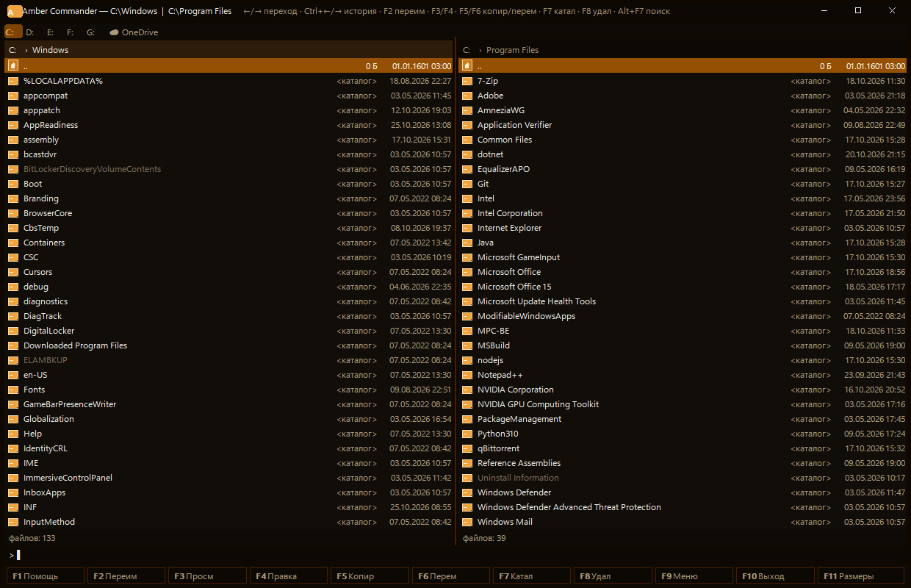
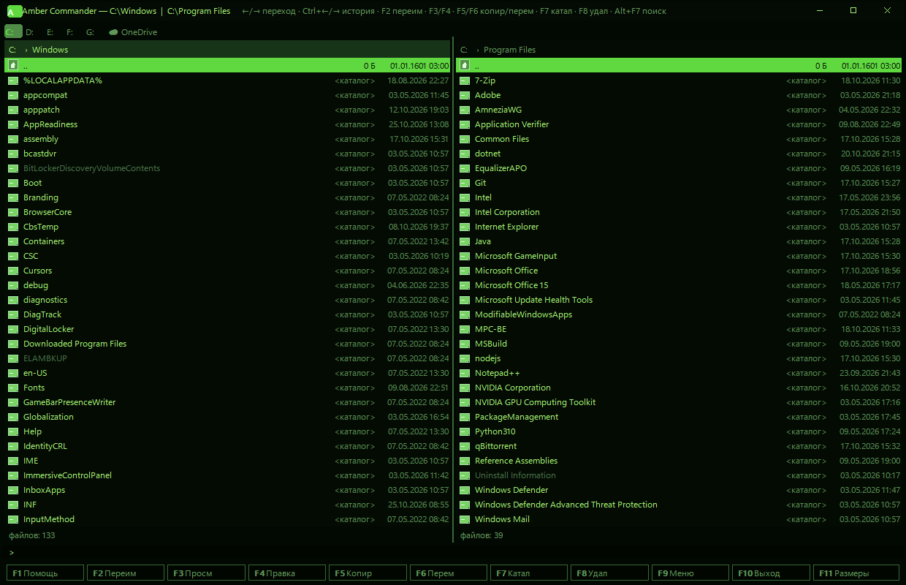
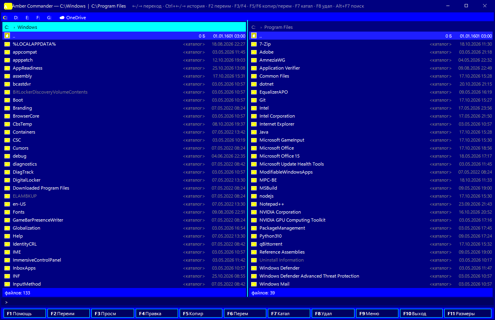
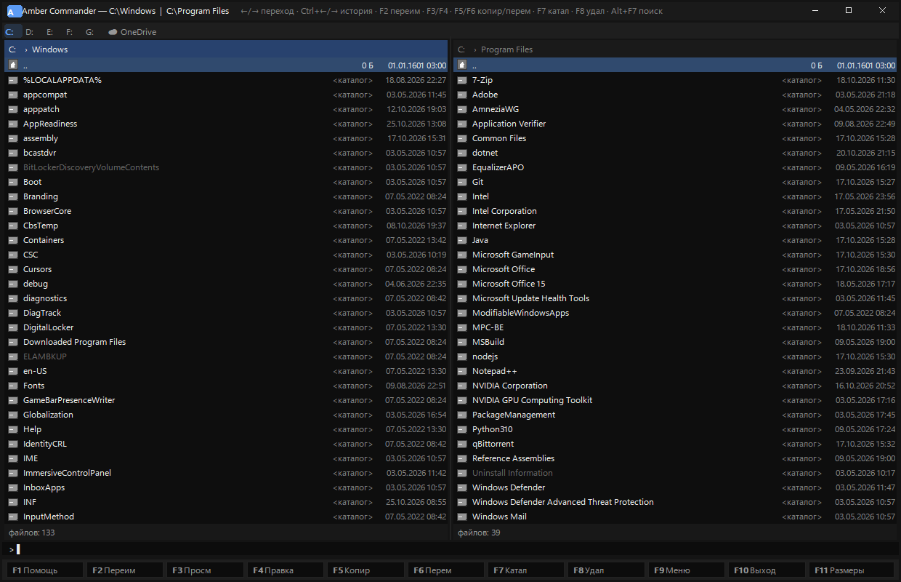

# Amber Commander

**Быстрый двухпанельный файловый менеджер для Windows в стиле Norton/Volkov Commander.**

Тёплый янтарный интерфейс, мгновенный старт и всё необходимое для работы с файлами —
без установки, без зависимостей, один exe-файл ~1,2 МБ.

## Скриншоты

<table>
<tr>
<td align="center"><b>Янтарь</b> (по умолчанию)<br></td>
<td align="center"><b>Фосфор</b> (зелёный монитор)<br></td>
</tr>
<tr>
<td align="center"><b>FAR</b> (классика VGA)<br></td>
<td align="center"><b>Уголь</b> (стиль OpenCode)<br></td>
</tr>
</table>

## Особенности

- **Мгновенно** — холодный старт ~70 мс, простаивает с 0% CPU и ~3 МБ памяти
- **Две панели** в стиле Norton/VC: Tab — переключение, Ctrl+U — обмен, Ctrl+O — скрыть
- **9 тем** (Ctrl+F12): Янтарь, Кофе/Какао, Холодная, Фосфор, Сталь, FAR, Спектр,
  Ночной циан, Уголь — цвета текста зависят от типа файла
- **Глобальный поиск каталогов**: начните набирать имя папки в командной строке —
  попап с результатами по всем дискам (Enter — открыть, Esc — закрыть).
  Индекс строится в фоне по MFT при запуске от администратора — миллионы каталогов
  находятся мгновенно
- **Командная строка**: `cd путь` — переход, любая команда — запуск как Win+R,
  набор текста — живой переход к файлу по префиксу
- **Хлебные крошки** в шапке панели: клик по сегменту — переход, «›» — подпапки
- **Просмотрщик F3**: текст, HEX, изображения, карточка файла; **Ctrl+Q** — быстрый
  просмотр в соседней панели
- **F4 — правка**: Notepad++ находится автоматически; если нет — диалог выбора
  редактора
- **F11 — размеры каталогов** (вид WizTree): полосы, Enter — внутрь, Del/F8 —
  удаление с пересчётом, ПКМ — контекстное меню
- **Полное системное контекстное меню Windows** (ПКМ): 7-Zip, антивирусы,
  «Открыть с помощью», «Свойства» — как в Проводнике
- **Drag&drop правой кнопкой** с подсветкой цели рамкой; защита от
  самоперетаскивания
- **Выделение**: Insert/Space, Shift+↑/↓, маски `+` `-` `*` (инверсия),
  Ctrl+A — всё, Ctrl+Space — снять
- **История переходов** Ctrl+←/→ (назад/вперёд)
- **Alt+F1/F2 — диски**; если соседняя панель уже на этом диске — синхронный
  переход в её каталог
- **ПКМ по шапке панели** — копирование пути каталога в буфер обмена
- **Портативность**: настройки в amber.ini рядом с exe; если запись запрещена
  (Program Files) — %APPDATA%\Amber Commander\amber.ini
- **Сохранение при выходе**: тема, каталоги панелей, геометрия окна

## Горячие клавиши

| Клавиша | Действие | Клавиша | Действие |
|---|---|---|---|
| F2 | Переименовать | Shift+F4 | Новый файл |
| F3 | Просмотр | Ctrl+F3…F6 | Сортировка: имя/расширение/размер/дата |
| F4 | Правка (редактор) | F7 | Создать каталог |
| F5 | Копировать | F8 / Shift+F8 | Удалить (в Корзину) / без подтверждения |
| F6 | Переместить | F9 | Меню (в т.ч. пользовательское) |
| F11 / Ctrl+L | Размеры каталогов | F10 / Alt+F4 | Выход |
| F1 | Справка | Alt+F7 | Поиск файлов |
| Alt+F1 / Alt+F2 | Диск левой/правой панели | Alt+Enter | Полный экран |
| Ctrl+Q | Быстрый просмотр | Ctrl+O | Скрыть панели |
| Ctrl+R | Обновить | Ctrl+U | Обмен панелей |
| Ctrl+\\ | Корень диска | Ctrl+F12 | Смена темы |
| Tab | Другая панель | Ctrl+←/→ | История переходов |
| Enter | Вход/открыть/команда | ← / Backspace | На уровень выше |
| Insert / Space | Выделить | Ctrl+Space | Снять выделение |
| Shift+↑/↓ | Выделение при движении | Shift+←/→ | Ширина панелей |
| `+` / `-` / `*` | Выделить/снять по маске/инверсия | | |

## Сборка

Требуется только [LLVM-MinGW](https://github.com/mstorsjo/llvm-mingw) (clang++)
и PowerShell. Никаких внешних библиотек — чистый WinAPI + Direct2D/DirectWrite.

```bat
build.bat
```

Результат: `amber.exe` (~1,2 МБ, x64, Windows 10/11).

## Тесты

Автотесты без участия человека (22 сценария: темы по эталонным пикселям,
глобальный поиск, удаление, перетаскивание, память/CPU и др.):

```powershell
powershell -NoProfile -ExecutionPolicy Bypass -File tests\autotest.ps1
```

Сценарии с модификаторами (Shift/Ctrl/Alt) синтетическим вводом не проверяются —
для них есть ручной план `ТЕСТ_ПЛАН.md`.

## Установка (по желанию)

```powershell
powershell -ExecutionPolicy Bypass -File install.ps1
```

Ярлык в меню «Пуск», `amber` в PATH, запуск от администратора (UAC) — для
мгновенного MFT-индекса каталогов и быстрых «Размеров». Портативный запуск
работает и без установки.

## Настройки

`amber.ini` (создаётся автоматически): тема, редактор, шрифт, подтверждения,
`[usermenu]` — пользовательское меню (F9). Пример — `amber.ini.example`.

## Лицензия

[MIT](LICENSE). Зависимостей нет, всё написано с нуля.

## Структура

```
src/          исходники (C++20, WinAPI)
res/          иконки
tests/        автотесты (autotest.ps1)
docs/         скриншоты
release/      готовые сборки (zip)
build.bat     сборка (LLVM-MinGW)
install.ps1   установка (Пуск, PATH, UAC)
```
